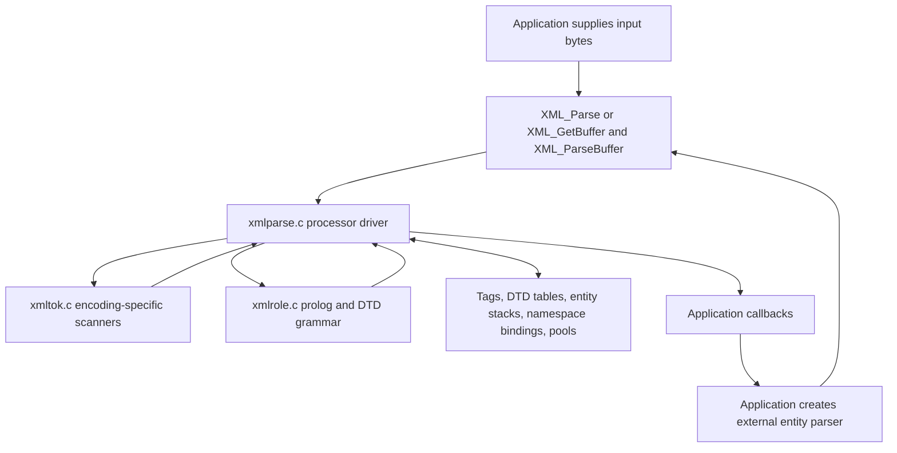

# Expat architecture and source map

[Guide index](README.md)

## The three execution layers

Expat scans bytes in their source encoding and converts strings when it needs to store them or expose them through the API. It retains incremental parsing state, an open-element stack, and DTD information instead of a document tree. This lets applications process documents as a stream, although pending tokens, declarations, and nesting can still consume substantial memory.

`xmltok.c` recognizes lexical units and validates their encoding and syntax. `xmlrole.c` interprets prolog tokens in grammatical context, distinguishing, for example, an element name from an entity name or an attribute type. `xmlparse.c` executes the semantics: it stores declarations, expands references, checks nesting, normalizes values, and calls handlers.

The separation is not a conventional lexer producing a permanent token stream. Scanners return a token identifier and a pointer into the current byte range. The parser consumes the result immediately. The role layer is used for the prolog and DTD; ordinary document content goes directly from tokenizer to content parser.

## File inventory

Only three C files are independent library translation units. The two other `.c` files below are included as templates by `xmltok.c`. See [`Makefile.am`](../expat/lib/Makefile.am).

| File under `expat/lib/` | Responsibility and reimplementation significance |
| --- | --- |
| [`xmlparse.c`](../expat/lib/xmlparse.c) | Public API implementation; parser state; processor dispatch; content, attributes, DTD semantics, entities, namespaces; allocation and resource accounting |
| [`xmltok.c`](../expat/lib/xmltok.c) | Encoding implementations, scanner instantiation, UTF conversion, encoding detection, XML declaration parsing, unknown encoding support |
| [`xmlrole.c`](../expat/lib/xmlrole.c) | Prolog and DTD grammar implemented as small functions that select the next state and return a semantic role |
| [`expat.h`](../expat/lib/expat.h) | Public functions, callbacks, errors, content-model representation, status enums, and version |
| [`expat_external.h`](../expat/lib/expat_external.h) | Public character and position types, calling convention, import and visibility macros |
| [`xmltok.h`](../expat/lib/xmltok.h) | Token constants, `ENCODING` dispatch interface, `ATTRIBUTE`, `POSITION`, scanner and conversion contracts |
| [`xmltok_impl.c`](../expat/lib/xmltok_impl.c) | Shared scanner algorithms instantiated through encoding-specific macros; includes content, prolog, literals, CDATA, ignored sections, attribute extraction, and position updates |
| [`xmltok_impl.h`](../expat/lib/xmltok_impl.h) | Byte classification constants such as `BT_LT`, `BT_NMSTRT`, `BT_LEAD2`, and `BT_NONXML` |
| [`xmltok_ns.c`](../expat/lib/xmltok_ns.c) | Included template for namespace and ordinary encoding initialization and XML declaration helpers |
| [`xmlrole.h`](../expat/lib/xmlrole.h) | `PROLOG_STATE`, role identifiers, initialization, and `XmlTokenRole` dispatch |
| [`ascii.h`](../expat/lib/ascii.h) | Numeric ASCII constants for XML syntax, independent of the compiler's execution character set |
| [`asciitab.h`](../expat/lib/asciitab.h) | Classification of the lower 128 input byte values |
| [`iasciitab.h`](../expat/lib/iasciitab.h) | Internal replacement-text classification; unlike `asciitab.h`, CR is `BT_S`, preventing external line-end normalization from being repeated in content |
| [`latin1tab.h`](../expat/lib/latin1tab.h) | Upper-byte classifications for Latin-1 |
| [`utf8tab.h`](../expat/lib/utf8tab.h) | UTF-8 lead, continuation, and invalid-byte classifications |
| [`nametab.h`](../expat/lib/nametab.h) | Compressed bitmap pages for XML name-start and name characters; part of this version's acceptance behavior |
| [`internal.h`](../expat/lib/internal.h) | Internal calling conventions, portability helpers, protection defaults, allocation alignment, and test hooks |
| [`siphash.h`](../expat/lib/siphash.h) | SipHash-2-4 implementation used by symbol and expanded-attribute hash tables |
| [`winconfig.h`](../expat/lib/winconfig.h) | Windows-specific includes and compatibility setup |
| [`libexpat.def.cmake`](../expat/lib/libexpat.def.cmake) | Windows exports and stable ordinals, with conditional feature exports |
| [`libexpat.map.in`](../expat/lib/libexpat.map.in) | Versioned ELF symbol exports, with conditional entries |
| [`Makefile.am`](../expat/lib/Makefile.am) | Autotools source list, public headers, library linkage, and test-library variant |

`Makefile.in`, when present, is generated build machinery. The generated `expat_config.h` lives outside this directory and supplies the platform and feature settings used throughout the core.

## Navigating the main parser

Rather than reading all of `xmlparse.c` sequentially, start with these symbol groups:

| Concern | Main symbols |
| --- | --- |
| State model | `XML_ParserStruct`, `DTD`, `TAG`, `ENTITY`, `OPEN_INTERNAL_ENTITY`, `BINDING`, `STRING_POOL`, `HASH_TABLE` |
| Construction and reuse | `parserCreate`, `parserInit`, `startParsing`, `XML_ParserReset`, `XML_ParserFree` |
| Input and continuation | `XML_Parse`, `XML_GetBuffer`, `XML_ParseBuffer`, `callProcessor`, `XML_StopParser`, `XML_ResumeParser` |
| Document phases | `prologInitProcessor`, `prologProcessor`, `contentProcessor`, `epilogProcessor`, `errorProcessor` |
| Content events | `doContent`, `storeRawNames`, `doCdataSection`, `reportProcessingInstruction`, `reportComment`, `reportDefault` |
| Start-tag semantics | `storeAtts`, `storeAttributeValue`, `getAttributeId`, `addBinding`, `freeBindings` |
| DTD semantics | `doProlog`, `defineAttribute`, `nextScaffoldPart`, `build_model`, `dtdCopy` |
| Entity continuation | `processEntity`, `internalEntityProcessor`, `appendAttributeValue`, `callStoreEntityValue`, `storeEntityValue` |
| External parsing | `XML_ExternalEntityParserCreate`, `externalEntityInitProcessor`, `externalParEntInitProcessor`, `getContext`, `setContext` |
| Storage and limits | `lookup`, `poolGrow`, `accountingDiffTolerated`, `expat_heap_increase_tolerable`, `expat_malloc`, `expat_realloc`, `expat_free` |

## Design choices and consequences

**Scanning source bytes preserves source positions.** Tokens refer to the original input, so byte indexes do not require mapping back from a fully transcoded document. It also allows direct character-data callbacks when the source and API encodings match. A rewrite that decodes everything first needs a separate source-offset map.

**Processor functions represent continuation state.** `m_processor` identifies what to do with the next bytes. CDATA, external-entity initialization, internal expansion, and epilog processing have their own continuations. A rewrite can use an enum and a dispatch loop, but it must retain the same unfinished work.

**Grammar recognition and DTD effects are separated.** The same token can mean different things depending on `PROLOG_STATE.handler`. The role machine validates declaration structure; `doProlog` performs storage and callbacks. Combining them is possible, but makes interruption and parameter-entity boundaries easier to mishandle.

**Interning and pooled storage keep identifiers stable.** Tables associate names with semantic objects; committed strings survive later pool growth. Free lists reduce repeated allocation for tags, bindings, and entity frames. The tradeoff is that a reset parser can retain its previous high-water allocation.

**Callbacks run synchronously inside parsing.** They can change handlers or request a stop. Consequently callback boundaries are control-flow boundaries. Some related events still occur after a stop request, as described in [Parser execution](parser-execution.md).

**DTD support serves parsing without full validation.** Declared types change attribute normalization and identify ID attributes; defaults change start-element arguments; entities can introduce more markup. Content models are reported to applications, not used to validate the document's element sequence.

## Build variants

The defaults here are from [`expat/CMakeLists.txt`](../expat/CMakeLists.txt), not assumptions about a particular installed binary.

| CMake option | Core definition | Default and effect |
| --- | --- | --- |
| `EXPAT_DTD` | `XML_DTD` | On; external subset and parameter-entity processing. Turning it off does not remove all internal DTD declaration handling |
| `EXPAT_GE` | `XML_GE` | On; general-entity expansion and resource accounting. `XML_DTD` requires this to be on |
| `EXPAT_NS` | `XML_NS` | On; compiles namespace support. Ordinary parser creation still leaves namespace processing off |
| `EXPAT_CHAR_TYPE` | `XML_UNICODE`, `XML_UNICODE_WCHAR_T` | `char` by default for UTF-8 output; `ushort` or supported two-byte `wchar_t` for UTF-16 output |
| `EXPAT_CONTEXT_BYTES` | `XML_CONTEXT_BYTES` | 1024; retains input context. Zero enables a direct-input path when no unconsumed bytes remain |
| `EXPAT_ATTR_INFO` | `XML_ATTR_INFO` | Off; enables source byte ranges for specified attributes |
| `EXPAT_LARGE_SIZE` | `XML_LARGE_SIZE` | Off; changes public position types from long to long long |
| `EXPAT_MIN_SIZE` | `XML_MIN_SIZE` | Off; reduces tokenizer specialization to trade speed for code size |
| `EXPAT_BUILD_TESTS` | `XML_TESTING` on test variants | On; builds tests and exposes internal instrumentation in the test library |

`XML_GE=0` is not simply an error-on-entity mode. `storeSelfEntityValue` supplies replacement text that causes a declared general entity reference to emerge as literal `&name;` text. The five predefined entities still have dedicated handling. Treat this as a separate compatibility profile.

The build also chooses byte order, entropy providers, visibility, and platform APIs. A binary replacement needs consistent public headers and feature exports, not just the same function names.
