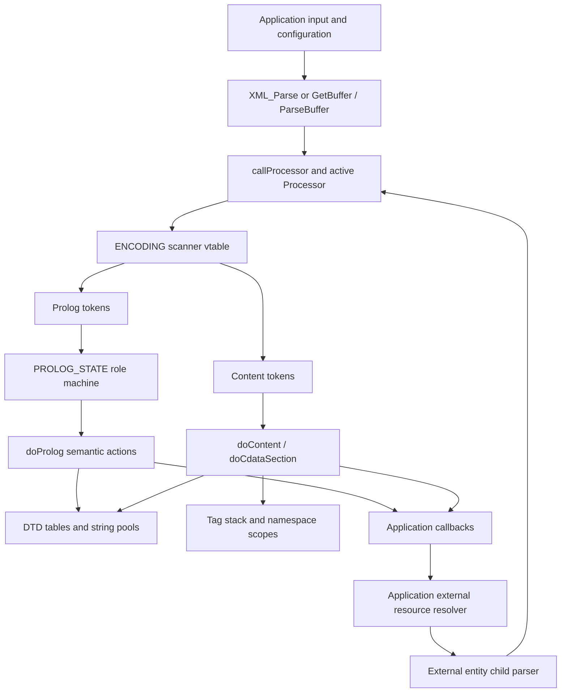

# Architecture and source map

## Overall design

Expat separates recognizing bytes, recognizing declaration grammar, and applying
XML semantics. Most semantic state is in one parser object in
[`xmlparse.c`](../expat/lib/xmlparse.c). Input is consumed as a bounded byte span;
events are emitted while scanning. Only unfinished input, open scopes, reusable
workspaces, and declarations need to survive calls.

The graph shows responsibilities, not an event queue: callbacks are synchronous
calls into application code. An internal entity schedules more parser work;
external entity loading happens only through application callbacks.

There are several separate kinds of state machine:

| Machine | State representation | Job |
| --- | --- | --- |
| Public lifecycle | `XML_ParsingStatus` | Initialized, parsing, suspended, or finished; whether input is final |
| Semantic parsing phase | `m_processor`, a `Processor *` | Initialization, prolog, content, CDATA, ignored section, epilog, entity work, or sticky error |
| DTD grammar | `PROLOG_STATE.handler` plus nesting counters | Assign grammatical roles to prolog tokens |
| Lexical context | Scanner index in `ENCODING` | Content, prolog, CDATA, ignored section, or a literal context |
| Nested XML scopes | Tag/binding/entity linked lists | Remember matching names, namespace shadowing, entity progress and recursion |

Combining these into one flat enum is possible but would obscure independent
constraints. For example, a parser can be publicly suspended while its next
processor is `internalEntityProcessor` and its document input cursor is already
past the entity reference.

## Complete library file inventory

[`Makefile.am`](../expat/lib/Makefile.am) compiles only `xmlparse.c`, `xmltok.c`,
and `xmlrole.c` as library translation units. Some other `.c` files are templates
included into `xmltok.c`; compiling those separately is incorrect.

| File | Responsibility and dependency |
| --- | --- |
| [`xmlparse.c`](../expat/lib/xmlparse.c) | Public API implementation; parser object; input buffers; semantic processors; DTD storage; entity work; attributes and namespaces; pools, hashing, models, positions, limits |
| [`xmltok.c`](../expat/lib/xmltok.c) | Encoding objects, conversion, encoding detection, XML declaration parsing, Unicode classification, and instantiation of scanner templates |
| [`xmltok.h`](../expat/lib/xmltok.h) | Internal token constants, `ENCODING`, `INIT_ENCODING`, `ATTRIBUTE`, `POSITION`, scanner and conversion contracts |
| [`xmltok_impl.c`](../expat/lib/xmltok_impl.c) | Included scanner template: tags, references, literals, comments, PIs, content, prolog, CDATA, ignored sections, attributes, positions |
| [`xmltok_impl.h`](../expat/lib/xmltok_impl.h) | `BT_*` lexical byte/character class enum used by scanner tables |
| [`xmltok_ns.c`](../expat/lib/xmltok_ns.c) | Included template producing namespace and nonnamespace initialization/internal encoding/declaration entry points |
| [`xmlrole.c`](../expat/lib/xmlrole.c) | Handwritten prolog/DTD finite-state grammar; maps token plus grammar state to `XML_ROLE_*` and next state |
| [`xmlrole.h`](../expat/lib/xmlrole.h) | Role enum, `PROLOG_STATE`, initialization, and role-dispatch macro |
| [`expat.h`](../expat/lib/expat.h) | Public types, callbacks, functions, status/error/feature enums, version, and behavioral contracts |
| [`expat_external.h`](../expat/lib/expat_external.h) | API visibility, calling convention, compiler annotations, public character and index types |
| [`internal.h`](../expat/lib/internal.h) | Internal calling conventions/visibility helpers, portability, default protection constants, testing declarations |
| [`ascii.h`](../expat/lib/ascii.h) | Explicit ASCII code values for XML syntax; avoids dependence on execution-character-set literals in scanner logic |
| [`asciitab.h`](../expat/lib/asciitab.h) | Initial 128 lexical classes for external encodings |
| [`iasciitab.h`](../expat/lib/iasciitab.h) | Corresponding internal-encoding classes; permits handling already-normalized replacement text correctly |
| [`latin1tab.h`](../expat/lib/latin1tab.h) | Upper 128 byte classes for ISO-8859-1 and relevant UTF-16 table construction |
| [`utf8tab.h`](../expat/lib/utf8tab.h) | Upper 128 classes for UTF-8 continuation/lead/invalid bytes |
| [`nametab.h`](../expat/lib/nametab.h) | Compressed bitmap/page tables for non-ASCII name and name-start membership |
| [`siphash.h`](../expat/lib/siphash.h) | Included SipHash implementation; parser uses SipHash-2-4 for name and expanded-attribute hashing |
| [`winconfig.h`](../expat/lib/winconfig.h) | Windows-specific portability definitions |
| [`libexpat.map.in`](../expat/lib/libexpat.map.in) | ELF export/version-script template, with feature-dependent symbols |
| [`libexpat.def.cmake`](../expat/lib/libexpat.def.cmake) | Windows DLL export template |
| [`Makefile.am`](../expat/lib/Makefile.am) | Authored Autotools source/install/test-library rules |
| `Makefile.in` | Generated Autotools build template, present in this working tree; not semantic parser code |

`expat_config.h` is generated outside this directory from build configuration.
It controls available features and platform facilities. `.deps/` and generated
makefiles are build artifacts. Useful sources immediately outside the core are
[`expat/CMakeLists.txt`](../expat/CMakeLists.txt),
[`expat/configure.ac`](../expat/configure.ac),
[`expat/gennmtab/gennmtab.c`](../expat/gennmtab/gennmtab.c),
[`expat/tests/`](../expat/tests), and [`expat/fuzz/`](../expat/fuzz).

## Navigating xmlparse.c by task

| Task | Symbols to start with |
| --- | --- |
| Construct, initialize, recycle, destroy | `parserCreate`, `parserInit`, `XML_ParserReset`, `XML_ParserFree` |
| Supply input and retain incomplete bytes | `XML_Parse`, `XML_GetBuffer`, `XML_ParseBuffer`, `callProcessor`, `storeRawNames` |
| Stop/resume and inspect state | `XML_StopParser`, `XML_ResumeParser`, `XML_GetParsingStatus` |
| Process document phases | `prologInitProcessor`, `prologProcessor`, `contentProcessor`, `epilogProcessor` |
| Dispatch semantics | `doProlog`, `doContent`, `doCdataSection`, `doIgnoreSection` |
| Resolve encodings/declarations | `initializeEncoding`, `processXmlDecl`, `handleUnknownEncoding` |
| Handle external fragments/DTDs | `XML_ExternalEntityParserCreate`, `externalEntityInitProcessor*`, `externalEntityContentProcessor`, `externalParEnt*`, `entityValue*` |
| Process internal replacements | `processEntity`, `internalEntityProcessor`, `storeAttributeValue`, `appendAttributeValue`, `callStoreEntityValue`, `storeEntityValue` |
| Build attributes and names | `storeAtts`, `addBinding`, `getAttributeId`, `getElementType`, `setElementTypePrefix`, `defineAttribute` |
| Preserve external parsing context | `getContext`, `setContext`, `dtdCopy`, `copyEntityTable` |
| Deliver miscellaneous events | `reportProcessingInstruction`, `reportComment`, `reportDefault`, `XML_DefaultCurrent` |
| Allocate/intern persistent state | `lookup`, `hash`, `hashTable*`, `pool*`, `dtdCreate`, `dtdReset`, `dtdDestroy` |
| Build element declaration models | `nextScaffoldPart`, `build_model` |
| Bound resource consumption | `accountingDiffTolerated`, `accountingGetCurrentAmplification`, `expat_heap_increase_tolerable`, `expat_malloc`, `expat_realloc`, `expat_free` |
| Report locations | `XML_GetCurrentByteIndex`, `XML_GetCurrentByteCount`, `XML_GetCurrentLineNumber`, `XML_GetCurrentColumnNumber`, `XML_GetInputContext` |

## Design decisions and consequences

**Streaming rather than tree storage.** Element nesting uses a stack, but closed
elements and character data do not accumulate into a document representation.
Applications can process documents larger than memory. Memory is still affected
by declarations, distinct interned names, maximum nesting, retained free lists,
and the largest unfinished token.

**Scan in the input encoding.** Most tokens retain pointers into original bytes.
Convert only values required for API output or persistent storage. This supports
raw tag-name comparison and original-byte positions, and allows direct character
callbacks when input already matches the API representation.

**Explicit continuations.** A processor function pointer carries the current
phase. Entity lists and progress counters carry replacement-text continuations.
This permits suspension and avoids native stack growth proportional to internal
entity depth. Selected phase transitions still make ordinary function calls;
this is not a claim that every function call has been eliminated.

**Interning and pools.** Repeated names share declaration records; many small
strings share larger allocations. Temporary pools and free lists amortize
per-event allocations. Pointer identity sometimes replaces string comparisons,
so ownership and scratch flags are part of the internal algorithm.

**Optional processing, persistent syntax checks.** A missing callback does not
make malformed XML acceptable. Some expensive representations, notably element
declaration content models, are built only when requested by a handler. Other
state is needed regardless of handlers, such as tag matching and namespace
bindings in namespace mode.

**Nonvalidating DTD support.** Declaration syntax, entity availability, attribute
normalization, defaults, and standalone-related rules affect parsing. Content
model validation, ID uniqueness, required-attribute enforcement, and enumeration
membership are not a general validation layer. A replacement must preserve this
boundary instead of treating DTD support as synonymous with validation.

**Security is distributed.** Expansion work is counted at token-consumption
sites; allocations have separate accounting; hashing has a root secret; input
buffer growth has its own overflow checks; reparsing uses a heuristic. A single
maximum-entity-depth option would not replace these protections.
