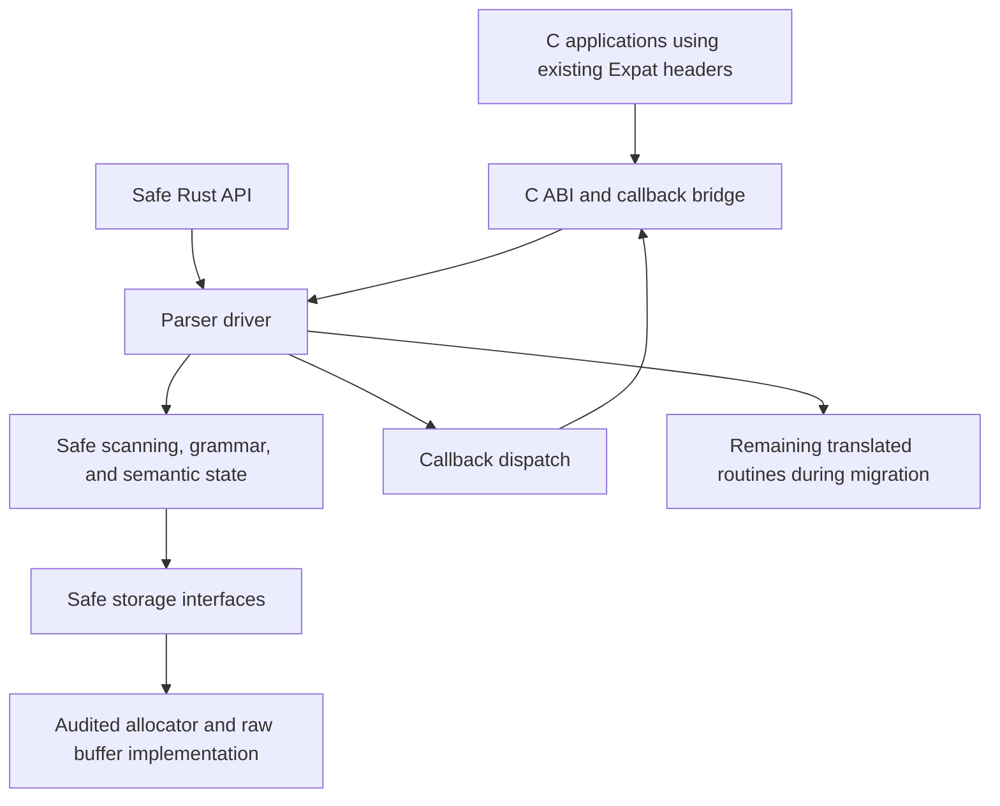

# Expat c2rust migration plan

[Guide index](README.md)

Incrementally refactor the c2rust translation into a safe parsing core, preserving the translated implementation as the behavioral baseline throughout the migration. The target is an idiomatic Rust implementation with a small, audited unsafe compatibility layer that remains a drop-in replacement for the corresponding Expat C library build. The hardest work is making ownership explicit while retaining callback, allocation, and continuation behavior.

This plan uses the compatibility analysis in this guide for Expat 2.7.4 at commit `7cbe6c52c068dcb0d6b135f6e09cd6ff68c983fa`. The library and tests are unchanged between that revision and checkout `24fbd05c2e6dbbdb3dc1ced90a6585872a9f6269`. At inspection on 2026-10-20, `translated_rust/` contained build artifacts naming `xmlparse.rs`, `xmlrole.rs`, and `xmltok.rs`, but those sources were absent. Recovering or regenerating the translation is therefore the first implementation prerequisite; this plan does not constitute an audit of the generated Rust.

C pointers, callbacks, and allocator hooks necessarily require unsafe code. C2Rust describes its output as an unsafe, behavior-preserving starting point requiring further migration work. [C2Rust documentation](https://github.com/immunant/c2rust#intro)

Each migrated subsystem replaces its translated counterpart. Keep one production parsing path, with the original C and frozen translation retained separately for testing.

## Establish the translated baseline

Recover or regenerate the three translated library units from a recorded compilation database. Record the C revision, c2rust revision, compiler target, generated configuration, and Rust toolchain.

Translation captures a particular preprocessed configuration. Adding Rust feature flags afterward cannot recover C branches excluded during translation. Generate reference translations for the required configurations, then consolidate their differences deliberately.

Begin with the ordinary UTF-8 callback ABI and DTD, general entities, and namespaces enabled. This profile must still support all its input encodings, including UTF-16 and unknown-encoding callbacks. Extend verification to Unicode callback ABIs, large positions, attribute information, context-buffer variants, and disabled features before claiming compatibility with those variants. Respect the valid configuration combinations described in [Architecture](architecture.md).

Run the existing C tests against the translated library before architectural edits. Fix translation or build defects separately so later failures have a clear cause.

## Preserve the public ABI

Keep the existing headers authoritative. Preserve exported symbols, numeric constants, callback signatures, public structure layouts, calling conventions, feature-dependent exports, and platform-sized integer types.

The opaque parser is not completely layout-independent: `XML_GetUserData` in [`expat.h`](../expat/lib/expat.h) reads its first pointer-sized field directly. The replacement handle must retain that field at offset zero.

Everything after that field can eventually become private Rust state. Use ordinary Rust enums internally, with explicit conversion at the ABI boundary. Do not impose Rust enum validity requirements on foreign integer inputs whose values need checking.

Binary acceptance also includes SONAMEs, ELF symbol versions, Windows exports and ordinals, library naming, and static linkage. Producing a `cdylib` with matching function names alone is insufficient. The full contract is described in [API compatibility](api-compatibility.md).

## Convert the tokenizer and grammar first

The tokenizer and prolog grammar have clearer interfaces and fewer ownership interactions than the main parser.

| Translated component | Proposed safe representation |
| --- | --- |
| Tokenizer pointer ranges | Borrowed byte slices and checked offsets |
| Token codes and output pointers | Typed scan results carrying valid ranges or error offsets |
| Encoding operation tables | Built-in encoding enum with shared scanner implementations |
| Prolog handler function pointers | Explicit grammar-state enum and transitions |
| Character classification tables | Immutable constants preserving the existing acceptance rules |

Preserve every scanner distinction: incomplete token, incomplete character, trailing CR, trailing brackets, invalid input, and the special incomplete prolog token classes. A simple `Option<Token>` loses information needed for compatible final-input errors.

Continue scanning original encoded bytes. Decoding the entire input into `String` first would complicate source positions, default-handler spelling, partial characters, and input-context reporting.

Initially retain translated tables and scanner specialization. Consolidate duplicate UTF-8/UTF-16 implementations only after bounded safe versions match the reference. Preserve the name acceptance tables rather than substituting general Unicode identifier predicates. See [Tokenization and encodings](tokenization-and-encodings.md).

## Replace persistent pointers with identities and offsets

| Existing representation | Replacement |
| --- | --- |
| Input/event pointers | Source identifier plus byte range |
| Pointers into interned strings | Stable `SymbolId` values |
| Entity, attribute, and element pointers | Typed arena indexes |
| Tag and entity linked lists | Explicit stacks with iterative cleanup |
| Namespace binding links | Binding indexes and scope restoration records |
| `ATTRIBUTE_ID.name[-1]` markers | Explicit per-tag presence state |
| Overlaid attribute records and callback pointers | Separate typed storage and ABI views |

Distinguish document input, external input, and internal replacement text. An entity event needs both its replacement-text range and its containing document reference location. One global offset cannot represent both correctly.

Introduce separate types for byte offsets, `XML_Char` lengths, and attribute-array indexes. Entity continuation uses bytes, while replacement-text length uses character units.

During migration, keep stable translated allocations until all users of their addresses have moved to handles. Replacing a pool with a growable vector while translated code still retains interior pointers would introduce dangling pointers. The ownership transitions must cover every consumer of each replaced representation. See [Data structures and memory](data-structures-and-memory.md).

## Make callback boundaries explicit

A parse function cannot hold an exclusive reference to the entire parser while invoking a callback that calls setters, queries positions, requests suspension, or creates an external parser. Wrapping the parser in `UnsafeCell` does not remove the exclusivity requirements of `&mut`. [Rust aliasing documentation](https://doc.rust-lang.org/std/cell/struct.UnsafeCell.html)

The eventual driver should:

1. Advance the core to the next callback boundary.
2. Save an explicit continuation and publish callback-visible metadata.
3. End conflicting borrows.
4. Invoke the current handler using stable argument storage.
5. Reacquire state and apply handler changes, stop requests, and continuation rules.

Resolve handlers at each delivery point. Precomputing a whole batch would miss changes made by earlier callbacks.

Preserve Expat's precise delivery sequence. An empty element's end callback can follow a start callback that requested suspension. Namespace notifications can precede a later error in the same start tag. Therefore callbacks cannot be deferred until an entire tag transaction succeeds. See [Parser execution](parser-execution.md) and [Attributes and namespaces](attributes-and-namespaces.md).

`XML_DefaultCurrent` needs access to the current original event range during dispatch. External parameter parsing must temporarily share DTD state without a parent borrow or lock remaining held across the callback.

Audit unknown-encoding callbacks and allocator hooks as foreign-code boundaries too. Their contracts differ, but ownership assumptions must remain explicit.

## Use allocator-aware storage behind safe interfaces

Full `XML_ParserCreate_MM` compatibility rules out replacing parser allocations indiscriminately with ordinary `Vec`, `String`, `Box`, and `HashMap`. Those allocations would bypass the supplied suite.

Introduce a small storage layer with safe interfaces for fallible buffers, typed arenas, string storage, and tables. Its implementation owns the unsafe allocation, alignment, initialization, growth, and destruction operations.

Preserve the allocation classes described in [Resource controls](resource-controls.md):

- Tracked internal allocations, charged to the parser family.
- Untracked input buffers.
- Raw-suite application allocations through `XML_Mem*`.
- Raw-suite exported `XML_Content` models.

A failed realloc must preserve the old allocation and accounting. All input-dependent growth must be fallible and checked for overflow. Standard collections remain useful in testing and wherever allocator compatibility permits; `try_reserve` addresses allocation failure but does not itself route allocations through the Expat suite. [Rust Vec documentation](https://doc.rust-lang.org/std/vec/struct.Vec.html)

`XML_GetBuffer` additionally requires tracking reserved versus initialized bytes. Safe code must not form a byte slice over unwritten capacity.

Initially preserve allocation sizes and growth behavior. Later representation changes can affect allocation-limit decisions and injected-failure points; those changes need explicit compatibility review.

## Represent parser families and resource policies directly

Introduce a family-owned resource object holding expansion accounting, tracked allocation state, and hash policy.

Preserve the external-entity distinction described in [DTD and entities](dtd-and-entities.md):

- General-entity children receive copied DTD state.
- Parameter-entity children share the parent DTD and operate synchronously.
- Both charge activity to the same root resource state.

Keep content expansion, attribute expansion, and entity-declaration expansion as distinct frame types. Their normalization and reference rules differ.

Retain the existing SipHash behavior initially. Changing maps prematurely can affect context serialization, allocation patterns, and explicit hash-salt behavior.

Preserve reparse deferral even if the safe scanner could resume more efficiently: it affects when callbacks occur. Preserve accounting at token-consumption points, including the exclusions that prevent charging rescanned input twice.

## Complete the semantic migration in bounded steps

| Stage | Work | Exit condition |
| --- | --- | --- |
| Baseline | Build and verify untouched translation | Existing tests and ABI probes pass |
| Pure logic | Grammar, classification, bounded scanning | Differential lexical and grammar results match |
| Infrastructure | Allocator wrappers, typed offsets, storage owners | Failure cleanup and buffer invariants hold |
| Callback control | Explicit dispatch boundaries and continuations | Callback mutation and stop/resume traces match |
| Semantic storage | Attributes, namespaces, DTD tables, entity frames | Ownership and parser-family tests pass |
| Driver | Replace remaining processor pointers and raw parser access | Safe core runs without translated machinery |
| Packaging | Remaining build profiles and platform exports | C clients link and behavior matches per profile |

This changes the sequence proposed for a fresh implementation in [Reimplementation and verification](reimplementation-and-verification.md). With c2rust, DTDs, namespaces, and entities already exist. Keep them operational while making their dependencies safe; do not remove them and rebuild feature coverage from scratch.

The first implementation milestone is a reproducible, tested c2rust baseline followed by a safe prolog grammar and bounded tokenizer interface. This provides a small, reviewable start while preserving the complete parser behavior needed for subsequent ownership migration.

## Dependency choices

Keep the runtime deliberately small. Use standard slices, enums, checked arithmetic, `Result`, and ownership types throughout the core. Blessed.rs lists `libc` for platform bindings, `bindgen` and `cc` for ABI/build tooling, `insta` for trace snapshots, and `criterion` for benchmarks. Those are useful candidates; none replaces Expat's grammar or allocator model. Keep the original public headers rather than generating replacements as the first step. [Blessed.rs crate catalog](https://blessed.rs/crates)

## Validation and completion

Compare the C reference, frozen translation, and current migration under the same scripted operations. Record callbacks, metadata, return values, errors, external-parser actions, and allocation ownership. Use semantic text coalescing for ordinary XML comparisons, but exact event boundaries for callback-driven stop/resume and timing tests.

The highest-value regression cases are every split point of short inputs, allocator failures, callback replacement, empty-element suspension, nested entities, shared parameter DTDs, unknown-encoding release, reset exceptions, and resource thresholds. Add ABI layout probes and real C client linkage. Use Miri for supported Rust components and memory instrumentation for integration testing. Reuse the reference commands, regression sources, and full behavior matrix in [Reimplementation and verification](reimplementation-and-verification.md).

Define panic handling explicitly. Expected parsing and allocation failures must return normal errors; unwinding must not escape the C ABI. `catch_unwind` can contain unwinding panics, but cannot recover aborting failures or establish that partially modified parser state is reusable. [Rust panic documentation](https://doc.rust-lang.org/std/panic/fn.catch_unwind.html)

Completion requires behavior and ABI compatibility for each declared build profile, correct allocation ownership and failure cleanup, preserved family resource budgets, and a safe parsing core whose remaining unsafe support code has explicit invariants. Passing basic XML tests or reducing the number of unsafe blocks alone does not establish those properties.
