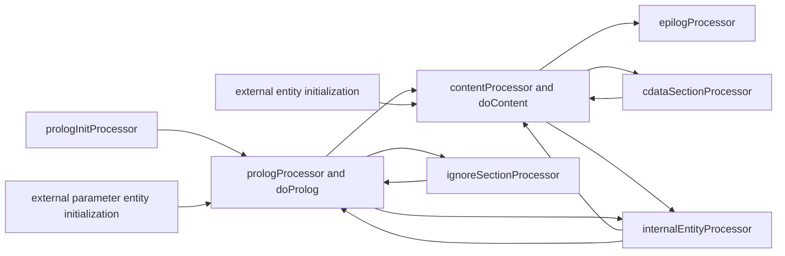

# Expat parser execution

[Guide index](README.md)

The execution path lives in [`xmlparse.c`](../expat/lib/xmlparse.c). The important state is both grammatical and operational: the parser must remember what XML construct is being read, what bytes remain, whether input is final, and whether a callback suspended processing.

## Creation and first input

`XML_ParserCreate`, `XML_ParserCreateNS`, and `XML_ParserCreate_MM` converge on `parserCreate`. It establishes the allocator, buffers, pools, DTD, encoding initialization object, and parser defaults. `parserInit` sets `m_processor` to the initial prolog processor, clears ordinary handlers, and sets the public state to `XML_INITIALIZED`.

The first parse on a root parser calls `startParsing`. It supplies a hash salt if none was set and installs the implicit `xml` namespace binding for namespace-aware parsers. The initial processor calls `initializeEncoding`; the initialization scanner then selects a concrete encoding as enough leading bytes arrive.

Keep construction failure separate from parse failure. Constructors return `NULL`; parsing records an `XML_Error` and returns `XML_STATUS_ERROR`. Partially initialized state must remain destructible.

## Input ownership and buffering

Two public paths feed the same processor machinery:

- `XML_Parse(parser, bytes, length, final)` accepts application bytes. Normally it reserves internal space, copies the input, and uses `XML_ParseBuffer`.
- `XML_GetBuffer(parser, capacity)` returns writable parser storage; the application fills it and calls `XML_ParseBuffer(parser, actualLength, final)`. The supplied length must describe bytes actually written within the reservation.

When `XML_CONTEXT_BYTES == 0` and there are no pending bytes, `XML_Parse` can parse directly from the application's range. It copies any unconsumed tail before returning. Open tag names that still reference this range must also be preserved by `storeRawNames`.

The allocated buffer has four pointers:

```text
m_buffer <= m_bufferPtr <= m_bufferEnd <= m_bufferLim
            |               |               |
            pending bytes   end of input    end of allocation
```

Bytes before `m_bufferPtr` have been consumed, although some may be retained for `XML_GetInputContext`. `XML_GetBuffer` compacts or grows the buffer, preserving pending bytes and the configured context prefix. It invalidates event/position pointers when it moves storage. Buffer growth and size arithmetic must be checked before copying.

A successful non-final parse means the supplied input has not caused an error. It does not mean all bytes produced events: an incomplete token or reparse deferral can leave bytes pending. A final call, including a zero-length call, forces resolution of the pending grammar and token state.

## Processor transitions



This diagram shows the main semantic transitions, not every initialization helper. External general entities use `externalEntityInitProcessor`, its second and third stages, and `externalEntityContentProcessor`. External parameter entities also have special entity-value initialization and processing when their bytes belong inside a declaration value. Failures in processor execution cause the public parsing wrappers to install `errorProcessor`, which preserves the failure.

Each processor takes a byte range and returns an error plus the point where consumption stopped. `callProcessor` repeatedly invokes the current processor while `m_reenter` requests further work. Internal entity expansion uses this loop to avoid unbounded C recursion. A suspended or finished status overrides the reentry flag.

## Content dispatch

`doContent` repeatedly calls `XmlContentTok`, sets the current event range, performs accounting, and dispatches:

| Token kind | Parser action |
| --- | --- |
| Start tag | Allocate or reuse a `TAG`, save raw and converted names, push it, process attributes and namespace bindings, report the start event |
| Empty element | Process a temporary name and bindings, report start and end events, then unwind bindings; no persistent open tag is needed |
| End tag | Compare raw name bytes with the open tag, pop it, reconstruct any namespace-expanded name, report end, restore bindings |
| Text | Deliver directly when encodings/alignment permit, otherwise convert through `m_dataBuf` |
| Newline | Deliver normalized LF to the character-data handler |
| Character reference | Validate the numeric value and encode it in the callback encoding |
| Entity reference | Handle predefined entities, expand a declared internal entity, call the external handler, skip when permitted, or report an error |
| CDATA opener | Report the boundary and use the CDATA scanner until its closing delimiter |
| Comment or PI | Convert and normalize payload, then call its handler or the default handler |
| XML declaration | Reject it here as a misplaced XML processing instruction |

Ordinary root-document content transitions to `epilogProcessor` when the root closes. The epilog accepts whitespace, comments, and processing instructions, and rejects additional document content with `XML_ERROR_JUNK_AFTER_DOC_ELEMENT`.

`startTagLevel` distinguishes a whole document from an entity fragment. Entity content may contain sibling elements or text, but must return to its entry nesting level; it cannot close an element opened outside the entity or leave one open for its caller to close.

## A complete document walkthrough

With namespace processing enabled and separator `|`, consider:

```xml
<?xml version="1.0"?>
<!DOCTYPE r [
  <!ENTITY greet "hello">
  <!ATTLIST r mode CDATA "auto">
]>
<r xmlns="urn:demo" a="x&#10;y">&greet;<n/></r>
```

1. Encoding initialization selects UTF-8. The prolog role machine permits the XML declaration only at the beginning and `processXmlDecl` reports it if requested.
2. `doProlog` creates the general entity `greet` and associates the default `mode="auto"` with element type `r`. Declaration handlers run if installed.
3. `XML_ROLE_INSTANCE_START` switches to content parsing without losing the opening `<r...>` bytes.
4. `storeAtts` normalizes `a`, preserving the LF introduced by `&#10;`. It installs the default namespace, removes the namespace declaration from the ordinary attribute array, and adds the defaulted `mode` attribute.
5. The namespace-start callback precedes the element-start callback. The element name is `urn:demo|r`; attributes are `a`, `x\ny`, `mode`, `auto`, followed by a null pointer. `XML_GetSpecifiedAttributeCount` returns 2, the number of array entries occupied by the explicitly specified ordinary attribute.
6. `&greet;` pushes an internal entity frame. The processor loop parses `hello` from stored replacement text and reports character data, then returns to the document bytes.
7. `<n/>` reports start and end for `urn:demo|n`. It inherits the namespace and introduces no namespace-declaration event of its own.
8. `</r>` reports the root end and then the end of the default namespace scope. The parser enters the epilog; final input completes successfully.

Character-data segmentation is not fixed by this example. A client must accept multiple adjacent callbacks for the same logical text. The exact spelling `x\ny` above denotes an LF in the value, not a literal backslash.

## Incomplete input

For input split as `<r a="hel` and `lo">text</r>`, the first range does not contain a complete start-tag token. The scanner returns `XML_TOK_PARTIAL`, the parser retains the whole unfinished token, and the attribute/start-element callbacks wait. Once enough bytes arrive, scanning starts from the token's beginning.

The tokenizer also distinguishes incomplete multibyte characters, a trailing CR that might become CRLF, and trailing `]` characters that might form the forbidden `]]>` sequence. These distinctions determine behavior at final input. Reparse deferral may delay a retry until pending input has grown sufficiently; final input bypasses deferral. See [Tokenization](tokenization-and-encodings.md) and [Resource controls](resource-controls.md).

## Suspension and abort

The public states are `XML_INITIALIZED`, `XML_PARSING`, `XML_SUSPENDED`, and `XML_FINISHED`. They are distinct from `m_processor` and `m_errorCode`; an ordinary parse error installs an error processor without necessarily setting the public state to `XML_FINISHED`.

`XML_StopParser(parser, XML_TRUE)` requests suspension from a callback. Parsing returns `XML_STATUS_SUSPENDED` after reaching an appropriate boundary. The parser retains pending source bytes, tags, bindings, entity frames, and final-buffer status. `XML_ResumeParser` continues those bytes and may suspend again. New input is rejected while suspended.

Stopping does not promise that the current callback is the last callback before return. An empty element's end callback follows its start callback even if the start callback requested a stop; namespace-end notifications can follow an element-end stop. Some conversion loops also finish their related callbacks. A replacement must preserve these event sequences rather than returning from every callback immediately.

`XML_StopParser(parser, XML_FALSE)` aborts; parsing reports `XML_ERROR_ABORTED`. Suspending an external parameter entity is prohibited (`XML_ERROR_SUSPEND_PE`). A child's stop does not automatically stop its parent; applications coordinate parser families, resuming the deepest suspended child first.

The internal `m_reenter` mechanism is not permission for applications to recursively feed the same parser from a callback. External entity parsing uses a separate parser, and `XML_ResumeParser` must be called outside callbacks.
