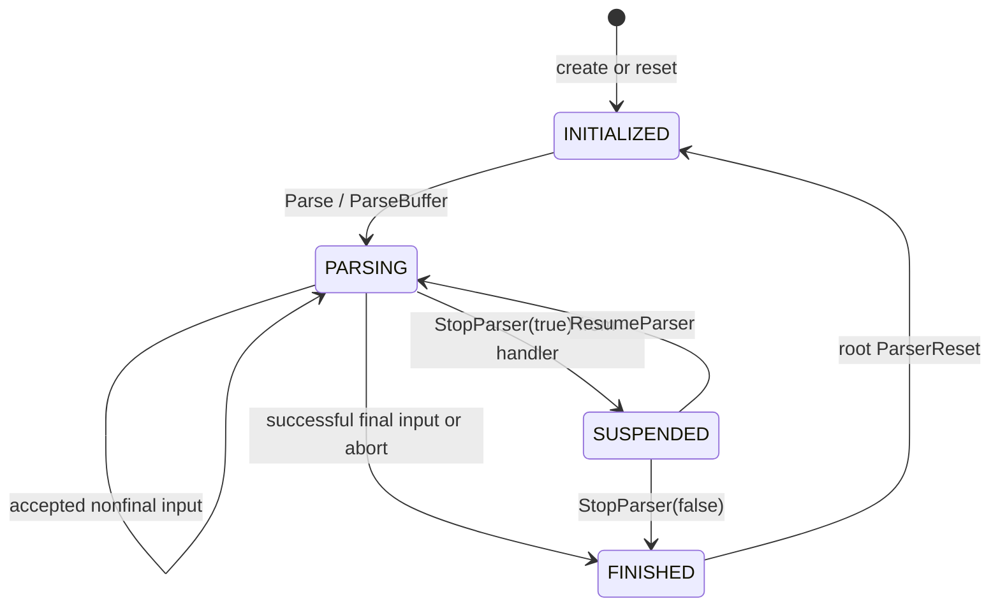

# Streaming parser walkthrough

The control flow described here is in
[`xmlparse.c`](../expat/lib/xmlparse.c), principally the public parse functions,
`callProcessor`, and the `*Processor`/`do*` functions. Scanner return contracts
are in [`xmltok.h`](../expat/lib/xmltok.h).

## Lifecycle and input

Create a parser, set handlers/options, feed byte spans, supply a final span,
then free or reset it. A successful nonfinal parse means the input received so
far has not caused an error; an unfinished token or an unclosed document can
still be buffered. Only a successful final parse establishes document completion.



This is the normal public lifecycle, not a complete error-state diagram. Fatal
syntax errors set `m_errorCode` and install `errorProcessor`; the public parsing
enum is not a separate success/failure indicator and need not become
`XML_FINISHED` for every error.

`XML_Parse(parser, s, len, isFinal)` validates null/length arguments and public
state. With context retention enabled, it obtains parser-owned space, copies
the bytes, and delegates to `XML_ParseBuffer`. With `XML_CONTEXT_BYTES == 0`
and an empty remainder, it can scan the caller's span directly and copy only
the unconsumed suffix afterward.

`XML_GetBuffer(parser, n)` ensures at least `n` writable bytes after buffered
input. It preserves the incomplete suffix and up to `XML_CONTEXT_BYTES` of
preceding context, compacts when possible, otherwise grows geometrically with
overflow checks. It invalidates event/position pointers if storage moves.

`XML_ParseBuffer(parser, n, isFinal)` commits `n` bytes that the application
has filled in space obtained through `XML_GetBuffer`. It does not obtain or
copy them. The caller must respect the requested capacity; this interface is
not a bounds-checking replacement for the application's buffer discipline.
Calling it initially without a successful buffer request yields
`XML_ERROR_NO_BUFFER`.

At the first parse of a root parser, `startParsing` initializes a hash secret
if none was supplied and installs the implicit `xml` namespace context in
namespace mode. Initialization of the actual input encoding is deferred to
the initial processor.

## Processor graph

```text
root:
  prologInitProcessor -> prologProcessor / doProlog
                     -> contentProcessor / doContent
                     -> epilogProcessor

external general entity:
  externalEntityInitProcessor -> InitProcessor2 -> InitProcessor3
                              -> externalEntityContentProcessor / doContent

external parameter entity:
  externalParEntInitProcessor -> externalParEntProcessor / doProlog
  (entityValueInitProcessor / entityValueProcessor in a replacement-value context)

side paths:
  doContent -> cdataSectionProcessor -> content phase
  doProlog  -> ignoreSectionProcessor -> prolog phase
  entity reference -> internalEntityProcessor -> saved document continuation
  fatal error -> errorProcessor
```

Each processor receives `[start, end)` and writes `endPtr` to the next document
input position. A complete document can transition through several processors
within one public call. `XML_TOK_INSTANCE_START` signals that prolog parsing
has reached the first element; it leaves the element bytes for `doContent`.
Completing the root element switches to the epilog, where only whitespace,
comments, and processing instructions are accepted.

CDATA and ignored-section processors preserve continuation across input calls.
They are specialized scanners, not recursive document parsing. External general
entity initialization separately handles encoding, an optional BOM, and an
optional text declaration before allowing a content fragment.

## callProcessor and progress

`callProcessor` is the common dispatch wrapper. It first applies reparse
deferral on nonfinal input. If the previous attempt made no progress on a partial
token, another attempt may wait until available bytes roughly double, unless
the next buffer request would force growth. It then loops on `m_processor` while
`m_reenter` requests a handoff. Suspension/abort status takes precedence over
that handoff flag. Final input bypasses deferral.

Simplified algorithm, omitting accounting and location bookkeeping:

```text
if nonfinal and deferral says to wait:
    next = start
    return success
next = start
repeat:
    result = processor(next, end, &next)
    if lifecycle is not PARSING: clear reenter
    if not reenter: break
    clear reenter
    if result is an error: return it
remember available bytes if no input was consumed, otherwise clear that history
return result
```

Internal-entity processors use their own replacement-text cursors while leaving
the document cursor past the reference. The loop lets them finish nested work
and return to the document without a call stack proportional to entity depth.

## Content token actions

`doContent` chooses either document event pointers or internal-entity event
pointers according to the encoding being scanned. It accounts consumed bytes,
dispatches a token, then checks suspension, abort, or processor handoff.

| Token family | Semantic action |
| --- | --- |
| Start tag | Allocate/reuse `TAG`, save raw and converted name, increment depth, call `storeAtts`, emit start, clear temporary strings |
| Empty element | Build temporary name and attributes, emit start then end, restore namespace bindings; no persistent tag frame is needed |
| End tag | Check entity depth boundary, compare original name bytes with open tag, pop/recycle tag, emit end, emit namespace ends and restore bindings |
| Data | Emit matching input directly or convert bounded portions into `m_dataBuf`; fall back to default handler if no character handler |
| CR/LF newline | Emit one LF through character handler; default handler instead receives original spelling |
| Numeric reference | Validate scalar and XML-character legality, encode in API representation, emit character data |
| Predefined entity | Emit one of `&`, `<`, `>`, apostrophe, or quote as character data |
| Other entity | Resolve declaration and applicability; expand internal text, invoke external handler, skip when permitted, or return an appropriate error |
| CDATA opener | Emit start-CDATA/default markup, switch to CDATA scanning until close, then emit end-CDATA/default markup |
| PI or comment | Normalize/convert payload for its handler, otherwise default reporting |
| XML declaration in content | `XML_ERROR_MISPLACED_XML_PI` |
| Invalid token | Set event to the offending source location and fail |

Raw start-tag names can initially borrow the current input span. On a successful
return from a content processor, `storeRawNames` copies any still-borrowed open
tag names into tag-owned storage before the input buffer may be reused. It stops
when it reaches a previously preserved frame because all older frames are
already safe.

## Incomplete input and finalization

Several scanner results require more bytes but are not equivalent:

| Condition | Nonfinal behavior | Final behavior depends on context |
| --- | --- | --- |
| Partial token | Preserve suffix | Usually `XML_ERROR_UNCLOSED_TOKEN` |
| Partial encoded character | Preserve suffix | `XML_ERROR_PARTIAL_CHAR` |
| Trailing CR | Wait to decide whether an LF follows | Treat CR as a newline when the grammar permits |
| Trailing `]` or `]]` in character content | Wait to exclude a split `]]>` | Emit literal brackets if otherwise legal |
| No remaining input | Wait or complete current phase | Root still required; unfinished elements/entity boundaries are errors; epilog succeeds |
| Unterminated CDATA | Continue CDATA processor | `XML_ERROR_UNCLOSED_CDATA_SECTION` |
| Partial DTD names or punctuation returned as negated tokens | Wait for disambiguation | `doProlog` resolves token kind and lets grammar determine validity |

An open root at end of input can produce `XML_ERROR_NO_ELEMENTS` through this
implementation's content-finalization path. An entity that opens/closes markup
across its own boundaries produces `XML_ERROR_ASYNC_ENTITY`; a parameter entity
that ends at an invalid declaration boundary can produce `XML_ERROR_INCOMPLETE_PE`.
Preserve the actual error mapping when targeting Expat compatibility.

## Worked trace: normalization and chunks

For UTF-8 input with start/end/character handlers:

```xml
<r a="x&#xA;y">A&amp;B
<![CDATA[<C>]]><e/></r>
```

Here `\r\n` denotes an actual CR/LF byte pair, not literal backslashes.
The attribute value becomes `x`, LF, `y`: a numeric newline reference survives
attribute whitespace normalization. The logical character stream is
`A&B\n<C>`. Its callback partition is unspecified.

An event trace, coalescing character data only for presentation, is:

```text
start r, attributes ["a", "x\ny", NULL]
text "A&B\n"
start CDATA                     (if registered)
text "<C>"
end CDATA                       (if registered)
start e, attributes [NULL]
end e
end r
```

If a chunk ends at `&am`, the complete reference remains buffered. If it ends
between CR and LF, the CR waits so the eventual line break is emitted once.
If it ends within `<![CDATA[`, no start-CDATA event is emitted for an incomplete
opener. Once inside CDATA, data can stream without buffering the whole section.
Reparse deferral can delay events even after a token becomes complete; final
input forces a decision.

## Suspension and abort

`XML_StopParser(parser, true)` from a callback marks suspension. The current
token may still require paired callbacks: stopping in the start callback for
`<e/>` does not suppress its end callback; namespace end callbacks can follow
an element end callback that requested a stop. Conversion of a single data token
may also involve more than one callback. Stop is observed at defined dispatch
boundaries, not as an arbitrary instruction-level interrupt.

The parse call returns `XML_STATUS_SUSPENDED` after saving its continuation.
Do not supply more input through `Parse`, `ParseBuffer`, or `GetBuffer` while
suspended. `XML_ResumeParser` consumes the saved remainder, including the saved
final-buffer flag; it can suspend again, finish, or need another input span.
External parameter-entity parsers cannot suspend resumably. A stop on a child
does not automatically stop its parent; the application controls that chain.

`XML_StopParser(parser, false)` aborts, normally making the enclosing parse call
fail with `XML_ERROR_ABORTED`. The API also allows aborting an already suspended
parser. Stopping an initialized parser yields `XML_ERROR_NOT_STARTED`; resuming
one that is not suspended yields `XML_ERROR_NOT_SUSPENDED`.

## Errors and source positions

`m_eventPtr` and `m_eventEndPtr` delimit the current original-input event.
`XML_GetCurrentByteIndex` computes:

```text
parseEndByteIndex - (parseEndPtr - eventPtr)
```

`XML_GetCurrentByteCount` returns the document event span length. There is a
contract discrepancy to preserve or resolve deliberately: the header says this
is zero inside an internal entity, but this checkout's getter simply subtracts
the document event pointers. A source-built trace of the nested `greeting` example
in [DTD processing](dtd-and-entities.md) reports 10 for both replacement-text
callbacks, the length of `&greeting;`. Internal event pointers still identify
replacement spans for internal processing; they do not make replacement bytes
part of the original document. Empty-element end events can be located at the
end of the empty tag when both element callbacks are present.

Line and column queries update position lazily from `m_positionPtr` to the event
start using the input encoding's `updatePosition`. Internal replacement events
have separate pointers so these queries do not subtract unrelated allocations.
`XML_GetInputContext` exposes retained original bytes when configured; the
pointer is borrowed, and the returned buffer may include more than the event.
Each external child has its own input position basis.

On a fatal processing error, public parse code makes the event end equal the
error event start and selects `errorProcessor`, which returns the stored error.
An API misuse such as supplying a negative length has its own return/error path;
do not assume every error follows identical lifecycle transitions.
